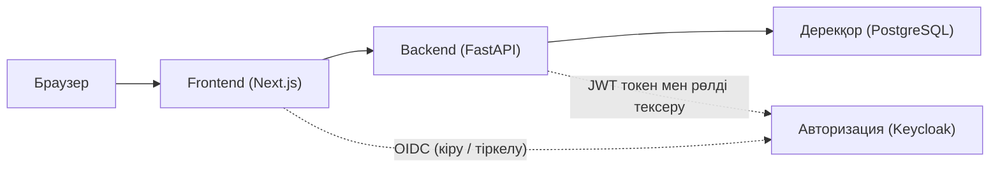

# Жоба архитектурасы (6-сабақ)

Бұл жоба — бір әзірлеуші 8 апта ішінде жасайтын **монолитті веб-қосымша**. Архитектурада артық микросервистер, брокерлер немесе күрделі инфрақұрылым жоқ; тек 5 негізгі компонент қолданылады.

## 1. Архитектура сызбасы (Mermaid `flowchart LR`)

---

## 2. Компоненттер сипаттамасы

| Компонент | Технология | Міндеті |
| :--- | :--- | :--- |
| **Браузер** | Web Client | Пайдаланушылардың (`teacher`, `student`, `admin`) веб-интерфейспен жұмыс істеу ортасы. |
| **Frontend** | Next.js (`web/`) | Мұғалімге мәтін енгізу мен нәтиже көру беттерін, оқушыға тест тапсыру интерфейсін көрсетеді. |
| **Backend** | FastAPI (`backend/`) | Монолитті REST API сервері (`/api/quizzes`, `/api/questions`, `/api/submissions`, `/api/users`), бизнес-логика және тест генерациясы мен ұпай есептеуді орындайды. |
| **Дерекқор** | PostgreSQL | Барлық кестелерді (`users`, `quizzes`, `questions`, `submissions`) сақтайтын реляциялық дерекқор (SQLAlchemy 2 + Alembic). |
| **Авторизация** | Keycloak (OIDC) | Пайдаланушыларды тіркеу, жүйеге кіргізу (`password` тек Keycloak-та сақталады) және `teacher`, `student`, `admin` рөлдерін JWT токен арқылы беру. |

