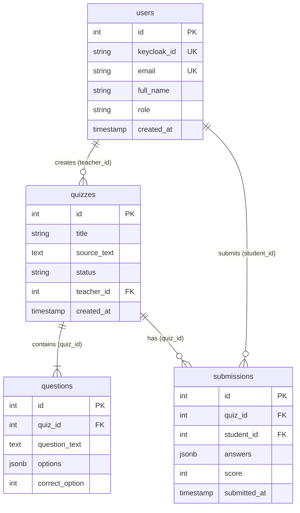

# ER-диаграмма және Дерекқор құрылымы (6-сабақ)

Бұл дерекқор сұлбасы тек [docs/user-stories.md](file:///c:/Users/2022/OneDrive/Рабочий стол/kurs/docs/user-stories.md) файлындағы **Must (`M`)** талаптарына (`US-1`, `US-2`, `US-3`, `US-4`) негізделген.
Авторизация **Keycloak (OIDC)** арқылы жүзеге асатындықтан, `users` кестесінде **`password` бағаны жоқ** (тек `keycloak_id` сақталады).

## 1. Mermaid ER-диаграммасы

---

## 2. Кестелер сипаттамасы

| Кесте атауы | Негізгі бағандар | Сипаттамасы және байланыстары | Қай Story үшін керек |
| :--- | :--- | :--- | :--- |
| **`users`** | `id` (PK), `keycloak_id` (UK), `email` (UK), `full_name`, `role` (`teacher` / `student` / `admin`), `created_at` | Keycloak OIDC арқылы кірген пайдаланушылар профилі (`password` сақталмайды). | `US-1`, `US-2`, `US-3`, `US-4`, `US-5` |
| **`quizzes`** | `id` (PK), `title`, `source_text`, `status` (`draft` / `published`), `teacher_id` (FK -> `users.id`), `created_at` | Мұғалім сабақ мәтінінен жасаған тесттер. | `US-1`, `US-2`, `US-3`, `US-5` |
| **`questions`** | `id` (PK), `quiz_id` (FK -> `quizzes.id`), `question_text`, `options` (JSONB: 4 нұсқа), `correct_option` (0..3) | Тест ішіндегі 10 сұрақ және олардың жауап нұсқалары. | `US-1`, `US-2`, `US-3` |
| **`submissions`** | `id` (PK), `quiz_id` (FK -> `quizzes.id`), `student_id` (FK -> `users.id`), `answers` (JSONB), `score`, `submitted_at` | Оқушылардың тапсырған тест жауаптары мен жинаған ұпайлары. | `US-3`, `US-4`, `US-6` |

