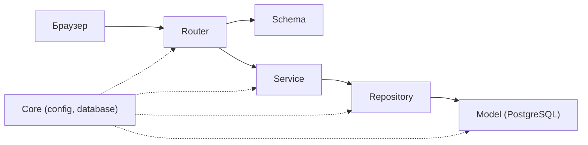

# Қабат картасы (4-сабақ)

| Қабат       | 1-әрекет: Азамат жаңа шағым жасайды | 2-әрекет: Модератор шағымды жабады |
|-------------|-------------------------------------|------------------------------------|
| Router      | POST /api/issues/ (Азамат рөлін Dependency арқылы тексеру) | PATCH /api/issues/{id} (Модератор рөлін Dependency арқылы тексеру) |
| Schema      | IssueCreate (мәтін ұзындығы мен міндетті өрістерді тексеру) -> IssueResponse | IssueUpdate (жаңа status мәнін валидациялау) -> IssueResponse |
| Service     | Бизнес-логика: спам еместігін және қайталанбауын тексеру | Бизнес-логика: шағымның бар екенін және ағымдағы күйін тексеру (жабық шағымды қайта жаппау) |
| Repository  | IssueRepository.create әдісімен базаға жазу (INSERT) | IssueRepository.update_status әдісімен базада жаңарту (UPDATE) |
| Model       | Issue ORM моделі: id, title, text, status="open", author_id, created_at | Issue ORM моделі: status бағаны (Enum: open / closed), updated_at |
| Қате-HTTP   | Валидация қатесі -> 422, Спам (бизнес-ереже) -> 400, Авторизация жоқ -> 401 | Құқық жоқ -> 403, Табылмады -> 404, Шағым бұрын жабылған -> 409 Conflict |

## Біздің ереже
- Router-де SQL жоқ, service-те HTTPException жоқ
- Құпиялар тек .env-те
