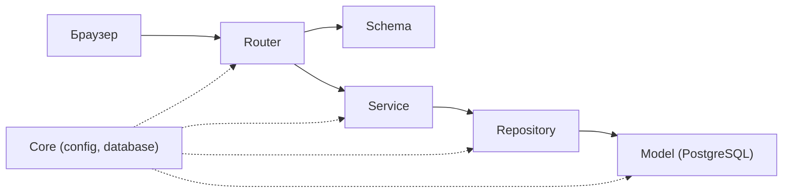

# Қабат картасы (4-сабақ)

| Қабат       | 1-әрекет: Мұғалім (`teacher`) жаңа тест құрастырады | 2-әрекет: Мұғалім (`teacher`) тестті жариялайды |
|-------------|-----------------------------------------------------|-------------------------------------------------|
| Router      | `POST /api/quizzes` (`teacher` рөлін Dependency арқылы тексеру) | `PATCH /api/quizzes/{id}` (`teacher` рөлін Dependency арқылы тексеру) |
| Schema      | `QuizCreate` (тақырып пен мәтін ұзындығын `>= 200` тексеру) -> `QuizResponse` | `QuizUpdate` (жаңа `status` мәнін валидациялау) -> `QuizResponse` |
| Service     | Бизнес-логика: мәтіннен 10 сұрақ құрастыру және қайталанбауын тексеру | Бизнес-логика: тесттің бар екенін, авторын және ағымдағы күйін тексеру |
| Repository  | `QuizRepository.create` әдісімен `quizzes` және `questions` кестелеріне жазу (`INSERT`) | `QuizRepository.update_status` әдісімен `quizzes` кестесінде жаңарту (`UPDATE`) |
| Model       | `Quiz` және `Question` ORM модельдері (`id`, `title`, `source_text`, `status="draft"`, `teacher_id`, `created_at`) | `Quiz` ORM моделі: `status` бағаны (`draft` / `published`) |
| Қате-HTTP   | Валидация қатесі -> `422`, Авторизация жоқ -> `401`, Рөл сәйкес емес -> `403` | Құқық жоқ -> `403`, Табылмады -> `404`, Қате күй -> `400` / `422` |

## Біздің ереже
- Router-де SQL жоқ, service-те HTTPException жоқ
- Құпиялар тек .env-те
